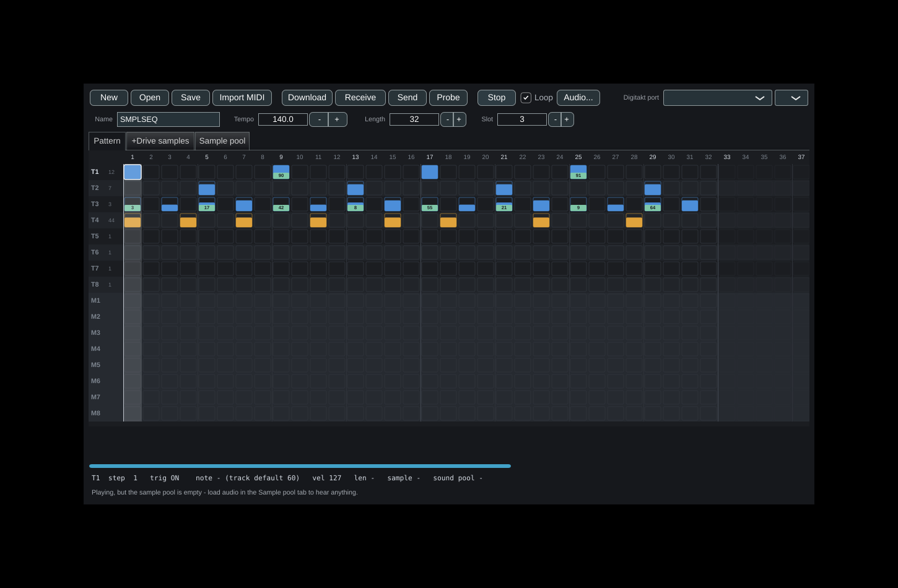
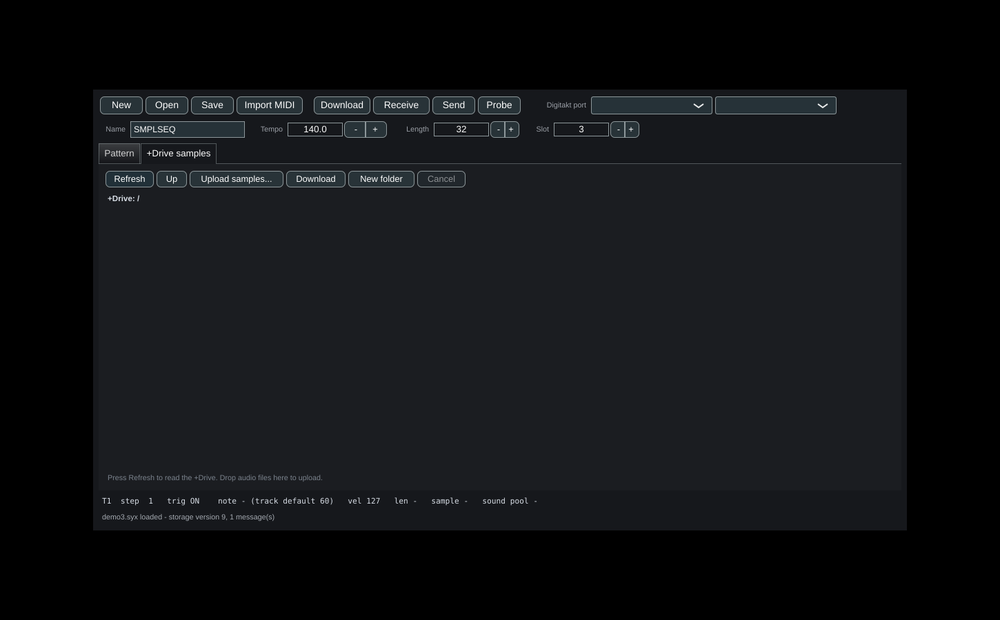
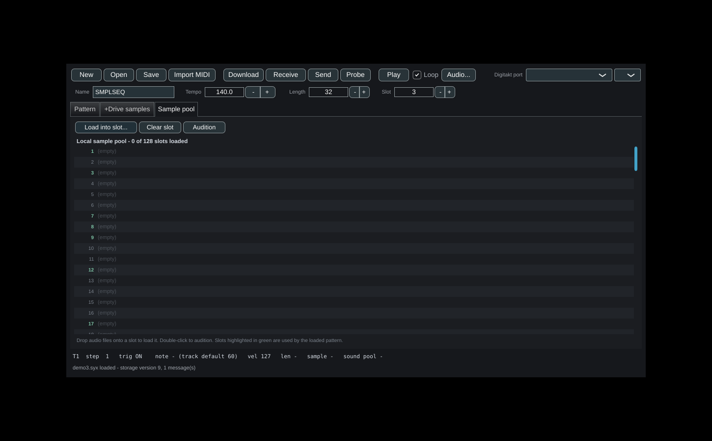
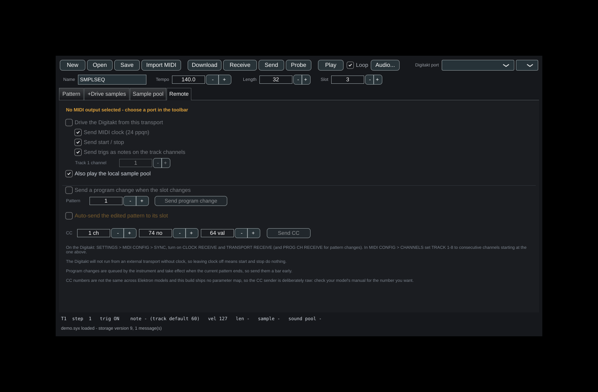
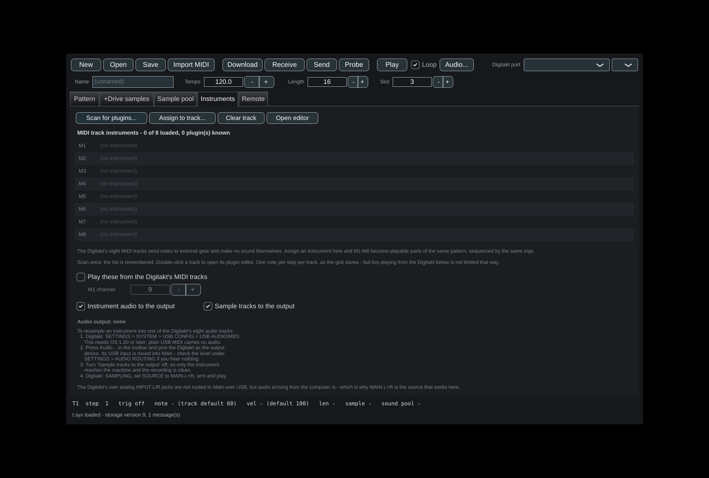

# Digitakt Pattern Editor (JUCE)

A native desktop app for the Elektron Digitakt: edit patterns, upload samples
to the +Drive, and sequence a different sample on every step.

**It also works with no Digitakt attached.** Load audio into the local sample
pool and it plays your patterns through the computer's audio output, so you
can write offline and send the result to the machine later.











Built for **Digitakt I on Linux**, but nothing here is Linux-specific — the
same CMake project builds on macOS and Windows.

## What it does

- **Pattern download** - ask the machine for a pattern, or a whole project,
  without touching the front panel.
- **Pattern editing** - open a `.syx`, edit the step grid, send it back.
- **MIDI file import** - quantise a Standard MIDI File onto the step grid.
- **Sample upload** - drag audio files onto the +Drive tab. Any format JUCE
  reads (WAV, AIFF, FLAC, Ogg, MP3), any rate, mono or stereo; it downmixes
  and resamples to the Digitakt's mono 48 kHz and uploads over USB MIDI.
- **Sample download** - select samples on the +Drive and save them as WAVs.
- **+Drive browsing** - list, navigate, create folders, assign a sample to one
  of the project's 128 pool slots.
- **Sample sequencer** - a different +Drive sample on every step of a track.
- **Offline playback** - a local 128-slot sample pool and an audio engine, so
  the app is a usable sample sequencer on its own.
- **Remote control** - drive the instrument from the editor's transport: MIDI
  clock, start/stop, and trigs as notes on the per-track channels.
- **VST3 / LV2 instruments on the MIDI tracks** - M1-M8 become playable parts
  of the same pattern.

---

## Instruments on the MIDI tracks

The Digitakt's eight MIDI tracks send notes to external gear and make no sound
of their own, so offline they were simply silent. The **Instruments** tab hosts
one VST3 or LV2 instrument per MIDI track: M1-M8 are then sequenced by the same
trigs, with the same note and velocity data, and mixed into the same output as
the sample tracks.

Scan once - the plugin list is remembered in
`~/.config/digitakt-editor/plugins.xml`. Only plugins that declare themselves
instruments are offered, because an effect cannot be sequenced from a MIDI
track. Double-click a track to open its plugin editor; plugins without an
editor of their own get JUCE's generic parameter view.

On Linux the usual search paths are `~/.vst3` and `/usr/lib/vst3`, and `~/.lv2`
and `/usr/lib/lv2`.

### Playing the instruments from the Digitakt

Turn on **Play these from the Digitakt's MIDI tracks** and the machine's own
MIDI tracks drive the plugins live: notes, CC, pitch bend and aftertouch all
pass through. Set the channel M1 sends on (M2 is the next one up, through M8)
to match `MIDI CONFIG > CHANNELS` on the instrument.

Live input is not limited to one note per step the way the sequencer grid is -
play chords on the Digitakt and the plugin gets them. Incoming MIDI is handed
straight to a `MidiMessageCollector` on the MIDI thread and consumed by the
audio thread at the right sample offsets, so timing survives rather than being
quantised to the audio block.

### Resampling an instrument into the Digitakt

Digitakt OS 1.20 added class-compliant USB audio, which is **two inputs as well
as two outputs**. Audio arriving from the computer is mixed into Main, and the
Digitakt can sample Main - so a hosted instrument can be recorded straight into
one of the eight audio tracks:

1. Digitakt: `SETTINGS > SYSTEM > USB CONFIG` = **USB AUDIO/MIDI**. Plain
   USB MIDI carries no audio, and this needs OS 1.20 or later.
2. Press **Audio...** and pick the Digitakt as the output device. The panel
   says whether the current output looks like a Digitakt. If you hear nothing,
   check the USB level under `SETTINGS > AUDIO ROUTING`.
3. Turn **Sample tracks to the output** off, so only the instrument reaches the
   machine. This silences voices already sounding, immediately - a ring-out
   would land in the recording.
4. Digitakt: `SAMPLING`, set `SOURCE` to **MAIN L+R**, arm and play.

The Digitakt's analog `INPUT L/R` jacks are *not* routed to Main over USB -
they are only audible while monitoring them for sampling. Audio from the
computer is, which is why `MAIN L+R` is the source that works here and
`IN L+R` is not.

Instrument audio and sample audio are separately mutable for exactly this
reason; one toggle is not enough.

### Limits

The grid stores one note per step per track, so the *sequencer* drives a MIDI
track monophonically even when the instrument is polyphonic - a retrig releases
the held note first. Live playing from the Digitakt has no such limit.

The plugin rack is local playback: nothing about it is written into the
pattern, and it does not change what the Digitakt's own MIDI tracks send to
your hardware.

Loading a plugin takes the rack's lock on the message thread, while the audio
thread only ever try-locks it. A load in progress therefore costs a few
milliseconds of plugin silence rather than an audio dropout.

Two details that are easy to get wrong and crash on real plugins:

**Channel count.** `processBlock` must be handed
`max(total inputs, total outputs)` channels, which for an instrument is often
more than two - multi-out and sidechain buses are common. A plugin can also
change its bus layout when one of its settings changes, so the requirement is
rechecked every block. If the scratch buffer is too small the slot is skipped
for that block, because processing anyway would write past the end of it.

**Editor lifetime.** `createEditorIfNeeded` returns the *same* editor object
every time, so there is exactly one window per slot: a second owning window
would delete the same editor twice. Closing a window destroys it rather than
hiding it, which is what tells the plugin its editor is gone, and a slot's
window is closed before that slot's plugin is replaced or cleared.

---

## Remote control

There is no protocol for live-editing a pattern that is already running on the
Digitakt - dumps move whole patterns, not single trigs. So live editing is
solved the other way round: **the editor becomes the master clock and plays the
instrument's own samples over MIDI**. Toggle a trig in the grid and the Digitakt
plays it on the next pass. Nothing is uploaded and no slot is overwritten.

The **Remote** tab keeps three things apart, because they carry very different
risk:

| | What it does | Writes to the machine? |
|---|---|---|
| **Drive** | clock, start/stop, trigs as notes on the track channels | no |
| **Follow** | a program change when the pattern slot changes | no |
| **Auto-send** | uploads the edited pattern to its slot after you stop typing | **yes, overwrites it** |

Auto-send is off by default and asks once before it is armed, because after
that it overwrites that slot on every edit with no further prompting. Point the
Slot field at a scratch pattern first. For live work, Drive is the better tool
anyway - the instrument stores what it receives, but a pattern that is already
playing may not pick up an uploaded change until you reselect it.

**On the Digitakt:** `SETTINGS > MIDI CONFIG > SYNC` - turn on CLOCK RECEIVE and
TRANSPORT RECEIVE, plus PROG CH RECEIVE for pattern changes. In
`MIDI CONFIG > CHANNELS` set TRACK 1-8 to consecutive channels starting at the
one set in the panel. The machine will not run from an external transport
without clock, so turning clock off makes start and stop do nothing.

Program changes 0-127 select patterns 1-128. The instrument **queues** the
change until the current pattern ends, so send it a bar early.

**No CC parameter map is shipped.** Published CC tables for the Digitakt II do
not necessarily hold for the Digitakt I, and a map that looks authoritative but
is wrong is worse than none. The CC sender is deliberately raw - channel,
number, value - so check your model's manual for the number you want.

---

## Standalone mode

Nothing here needs the instrument. Open or create a pattern, drop audio files
onto the **Sample pool** tab, and press **Play**.

The pool mirrors the Digitakt's 128 slots. A pattern refers to slots by number,
so the pool is what gives those numbers meaning locally. Slots the loaded
pattern actually reaches for are highlighted in green, which makes it obvious
what you still need to fill. Drop a file onto a slot to load it there; drop
several and they fill the free slots from that point. Double-click to audition.

Playback follows the instrument rather than inventing its own behaviour:

- eight audio tracks, each **monophonic** - a new trig steals that track's
  voice, as the Digitakt does
- a step's **sample p-lock** overrides which slot fires, so the sample
  sequencer is audible, not just editable
- **NOTE** transposes the sample, with 60 as original pitch
- **VEL** scales gain and **LEN** gates the voice in steps
- the grid is sixteenths, so a step is `60 / bpm / 4` seconds

A playhead follows the sequence across the grid. Loop is on by default; turn it
off and the pattern plays once and stops.

`Audio...` opens the device chooser if the default output is not what you want.
If no output can be opened at all, everything else still works - editing, MIDI
import, and talking to the Digitakt - and pressing Play says so.

The audio thread never touches the pattern data. Edits are published as a small
plain-data snapshot into a ring of buffers with an atomic index, so you can edit
while it plays without locks, allocation or dropouts.

---

## The sample sequencer

The Digitakt gives each audio track one sample from its kit, but any step can
override which sample slot fires. That override is a **parameter lock**, stored
in one of the pattern's 80 p-lock lanes: claim a lane by setting its parameter
id to the sound version's sample parameter and its track to the audio track,
then write a slot number per step.

That is what "sample sequencer" means on this machine, and it is what the grid
now edits. Press `s` / `S` on a step to set its sample slot, `d` to clear it.
Locked steps show the slot number on a green strip:

```
  T3   3  ▪17 ▪42 ▪ 8 ▪55 ▪21 ▪ 9 ▪64      <- eight hats, eight different samples
```

Lanes are managed automatically: locking a step claims a lane, and clearing the
last lock in a lane hands it back, so the 80-lane budget is not eaten by empty
lanes. elk-herd decodes these lanes but never writes them; this does both.

---

## Why this is a port, not a wrapper

JUCE is C++ and the previous tool was Python, so wrapping would have meant
shipping a Python runtime and marshalling 27 KB dumps across a process
boundary on every edit. Instead the format layer was ported to C++
(`DigitaktCore.h/.cpp`, ~1,100 lines) and the Python tool is left intact for
scripting.

**The port is verified, not assumed.** `DigitaktCore` has no JUCE dependency,
so it compiles and tests standalone. One of those tests builds a pattern with
a known set of edits and writes it out; the Python implementation builds the
same pattern independently. The two files hash identically:

```
python:  31613 bytes  sha256 94909e823e477dbf25a7bd148eb24e3c
c++   :  31613 bytes  sha256 94909e823e477dbf25a7bd148eb24e3c
```

That matters because a dump is ~27 KB of which this code models about 2%.
Everything else is captured verbatim and written back untouched. All ten
Digitakt storage versions round-trip byte-for-byte, enforced by the tests.

---

## Build

Dependencies on Linux Mint / Ubuntu:

```bash
sudo apt install build-essential cmake git \
     libasound2-dev libx11-dev libxext-dev libxinerama-dev libxrandr-dev \
     libxcursor-dev libxcomposite-dev libfreetype-dev libfontconfig1-dev
```

Then:

```bash
cmake -S . -B build -DCMAKE_BUILD_TYPE=Release
cmake --build build -j$(nproc)
```

JUCE is fetched automatically the first time (~200 MB). If you already have a
checkout, skip the download with `-DJUCE_PATH=/path/to/JUCE`.

The binaries land at:

```
build/DigitaktPatternEditor_artefacts/Release/Digitakt Pattern Editor
build/dtk-send_artefacts/Release/dtk-send
```

Run the core tests with `cd build && ctest --output-on-failure`, or the test
binary directly for the per-check listing.

`NEEDS_WEB_BROWSER FALSE` and `JUCE_WEB_BROWSER=0` are set, so you don't need
webkit2gtk — which is the dependency that usually makes JUCE builds annoying
on a fresh Linux box.

---

## Using it

```bash
"./Digitakt Pattern Editor"              # empty pattern
"./Digitakt Pattern Editor" mine.syx     # open a file directly
```

**Ports** are detected automatically: any MIDI device whose name contains
"digitakt" or "elektron" is selected on launch, and the list re-scans every
two seconds so hot-plugging works. On the Digitakt set
`SETTINGS > SYSTEM > USB CONFIG > USB MIDI` first.

**Download** is the easy direction: it *asks* the machine to send, so there is
nothing to press on the Digitakt. Choose a single pattern (1-128) or the whole
project. The dump protocol has request messages alongside the responses - same
envelope, empty payload - and this sends them.

A whole-project download also brings the **sample pool**, which is what you
need before you can assign +Drive samples to slots. It sends all 128 patterns,
so it takes a minute. There is no end-of-transfer marker in the protocol: the
project settings always arrive last, so that message ends the transfer, with an
idle timeout as a fallback so a stalled download keeps whatever arrived.

**Receive** is the manual alternative, for cases where the machine will not
answer a request: it listens while you trigger the dump yourself
(`SETTINGS > SYSEX DUMP > SYSEX SEND > PATTERN > YES`), then press Stop.

Both directions need `INPUT FROM` **and** `OUTPUT TO` set to include USB - a
download has to send a request and hear the answer.

**Send** puts the device instructions in the confirmation dialog, because
getting the order wrong is the usual reason a transfer silently does nothing:
the Digitakt must already be at `WAITING DATA` under
`SETTINGS > SYSEX DUMP > SYSEX RECEIVE > PATTERN`.

**Import MIDI** quantises a Standard MIDI File onto the step grid, mapping
channel *n* to track *n*. It reports what it had to drop rather than hiding it
— notes past the pattern end, and notes colliding on a step already in use,
since the sequencer holds one trig per step per track.

### The grid

Click or drag to toggle trigs. Blue is a plain trig; amber means it carries a
note lock. Fill height shows velocity, so dynamics read at a glance without
opening the inspector. Steps past the pattern length are dimmed. Audio tracks
show their sample slot next to the label.

| key | action | key | action |
|---|---|---|---|
| arrows | move | `space` | toggle trig |
| `n` / `N` | note down / up | `v` / `V` | velocity down / up |
| `l` / `L` | length down / up | `c` | clear this step's locks |
| `C` | clear track | | |

### Uploading samples

The **+Drive samples** tab lists the drive. Drop audio files onto it, or use
Upload samples. Before anything is sent you get a confirmation showing total
size and exactly which conversions were applied:

```
Upload 3 samples (412 KB) to /drums?

Conversions applied:
  break_140: 2 ch -> mono, 44100 -> 48000 Hz
  vocal_chop: peaks clipped
```

Select one or more samples and press **Download** to pull them off the drive
and save them as 16-bit mono WAVs. Existing local files are never overwritten -
a second copy becomes `name (2).wav`. Folders are not walked recursively; select
the files you want. Transfers run at MIDI speed, so a long sample is not quick.

Double-click a sample to assign it to one of the project's 128 pool slots.
Pool slots reference samples by **content hash and size, not path**, so the
link survives moving the file around the +Drive - and re-uploading a deleted
sample silently repairs it.

Assigning to a slot needs the project settings dump, which a pattern dump does
not contain. Receive a whole project if you want to edit the pool. Sequencing
sample slots from the Pattern tab needs nothing extra - a pattern only stores
the slot number.

**Probe** diffs the loaded pattern against a `.syx` on disk and labels every
changed byte by structure and field. That's how the per-step lock map was
worked out, and how you verify it: dump a pattern, change one thing on the
device, dump again, compare.

---

## Confidence

| Field | Confidence | Basis |
|---|---|---|
| 7-bit codec, checksum, envelope | **Certain** | Port of elk-herd; round-trip tested |
| Struct offsets and versions | **Certain** | From elk-herd, generated from Elektron's headers |
| Trigs, sample-slot p-locks | **Certain** | elk-herd decodes these |
| Tempo, pattern length | **High** | Blank reads 14400/120 = 120 BPM and 0x0010 = 16 steps |
| Per-step note, length | **High** | Array defaults 0x3C and 0x0E match the track default block `3c 64 0e` |
| Per-step velocity | **Medium** | Correct by field order, but 0xFF in every blank, so no distinctive default confirms it |
| Eight other per-step arrays | **Unknown** | Preserved exactly, never interpreted |
| +Drive API: dir ops, file transfer | **Certain** | Port of elk-herd's message definitions |
| Sample slot p-locks | **Certain** | elk-herd decodes these; encoding is the inverse |
| Dump request messages | **Certain** | Byte-exact against elk-herd's builder and the Python port |
| OS build to storage version table | **Certain** | elk-herd's `digitaktVersions` |
| Program change 0-127 = pattern 1-128 | **Certain** | Digitakt manual |
| Per-track MIDI channels, clock required | **Certain** | Digitakt manual |
| USB audio in is mixed to Main, and Main is samplable | **High** | Elektron OS 1.20 notes and the manual's sampling sources |
| Digitakt I CC numbers | **Not shipped** | Published tables cover the DT II; the CC sender is raw |
| Bulk SysEx needs rawmidi on Linux | **High** | JUCE's sequencer path discards the ALSA error code |
| Slot numbering (1-based, 0 = none) | **High** | Matches elk-herd's default-kit check; affects local playback only |
| +Drive sample file format | **Certain** | Port of elk-herd's `prepSamples` |

Verify velocity with Probe before trusting it: dump a pattern, put a velocity
p-lock on one step, dump again, and check the diff names `lock:velocity`
rather than one of the `unk_*` arrays.

---

## Layout

```
Source/DigitaktCore.h/.cpp   pattern format + sample-lock lanes (no JUCE)
Source/ElektronApi.h/.cpp    +Drive protocol: dir ops, chunked file transfer (no JUCE)
Source/BlankData.cpp         blank patterns v0-v9, RLE, generated
Source/SampleImport.h/.cpp   audio file -> mono 48 kHz -> +Drive sample format
Source/ApiClient.h/.cpp      request/response loop, ids, timeouts, upload queue
Source/SamplesPanel.h/.cpp   +Drive browser and drag-and-drop upload
Source/DigitaktMidi.h/.cpp   device I/O + MIDI file import
Source/PatternGrid.h/.cpp    the step grid
Source/MainComponent.h/.cpp  window, tabs, toolbar, inspector
Source/Main.cpp              entry point

Source/DumpRequester.h/.cpp   requests patterns and whole projects
Source/SamplePool.h/.cpp      128 local slots, lock-free for the audio thread
Source/SequencerEngine.h/.cpp the offline sequencer and voices
Source/PoolPanel.h/.cpp       the sample pool tab
Source/RemotePanel.h/.cpp     remote control settings
Source/RawMidiOut.h/.cpp      ALSA rawmidi bulk output (the reliable path)
Source/PluginRack.h/.cpp      one hosted instrument per MIDI track
Source/InstrumentsPanel.h/.cpp  scanning and assignment UI
Tools/dtk-send.cpp            GUI-free sender for isolating transfer problems

Tests/TestCore.cpp           46 checks - format, round-trip, sample locks, requests
Tests/TestApi.cpp            53 checks - protocol, transfers and decoding vs a mock
Tests/TestSampleImport.cpp   15 checks - downmix, resample, header
Source/Log.h/.cpp             flushed logging and the crash handler

Tests/TestRack.cpp           11 checks - plugin hosting against fake plugins
Tests/TestEngine.cpp         59 checks - step timing, voices, gating, locks,
                                         clock, transport, note output, rack
                                         routing and live MIDI input
```

184 checks in total, `ctest --output-on-failure` runs all five. The rack tests
use stand-in plugins that report more than stereo and change channel count
mid-session, so the hosting bugs that only show up with a real VST are caught
without one installed. The engine
tests drive the audio callback directly with scratch buffers and capture the
generated MIDI through a stub sink, so both halves are verified without a sound
card or an instrument: four-on-the-floor lands within two samples of each beat
and stays there at odd block sizes, one bar produces exactly 96 MIDI clocks
with under half a millisecond of jitter, and every note that goes out comes
back off - including when a retrig lands on a track that is still holding one.
The plugin rack exposes the MIDI it has queued for each slot, so instrument
routing is verified with no plugin installed: a trig on M3 reaches rack slot 3
and no other, audio-track trigs never leak into the rack, and MIDI trigs with
nothing loaded stay silent instead of crashing. Live input is checked the same
way: channel 9 reaches M1 for notes and CC alike, a channel below the base is
ignored rather than wrapped, and the two audio mutes are independent.

The Python package still ships alongside this for scripting and batch work —
its `--map` option for custom MIDI channel routing has no GUI equivalent yet.

## The log

Every run writes to:

```
~/.config/digitakt-editor/digitakt-editor.log
```

The previous run is kept beside it as `digitakt-editor.previous.log`, so the
restart after a crash does not overwrite the report of the crash.

Every line is flushed as it is written rather than buffered. That costs a
little speed and buys the one thing that matters when diagnosing a crash: the
last line before it actually reaches the disk.

The log records the audio device and its rate and block size, MIDI ports as
they open, plugin loads with their channel counts and latency, editor windows
opening and closing, and any change a plugin reports about itself.

**Crashes are caught and traced.** A fatal signal - SIGFPE, SIGSEGV and the
rest - writes a stack trace into the log under `trace` before the process
dies. The build passes `-rdynamic` and `-fno-omit-frame-pointer` so those
traces name functions instead of printing bare addresses.

A note on SIGFPE in particular: on Linux it means **integer** division by zero.
Floating-point maths produces NaN or infinity, never a signal. So a "floating
point exception" from a plugin is an integer divide, usually by a sample rate,
block size or channel count that arrived as zero.

### When a plugin's own GUI is the problem

If a plugin crashes or misbehaves in its own interface, tick **Generic
parameter editor** before opening it. That shows a plain list of the plugin's
parameters instead of its GUI, so the plugin still works - you just do not run
its interface code. The audio side is unaffected either way.

The host side of editor handling is deliberately hands-off: the window adopts
whatever size the editor asks for, and is only made resizable if the editor
says it is resizable. A fixed-size VST3 view that gets resized anyway is being
told its dimensions are something it never agreed to, and plugins do layout
arithmetic on those numbers. No minimum size is forced; a genuinely degenerate
size is rescued to 400x200 only because zero is a number things get divided by.

### Reading a crash trace

A trace with frames inside a plugin's `.so` and none of this app's own
functions between them and the signal is a fault inside that plugin. To turn
its addresses into source locations:

```
addr2line -e /path/to/Plugin.so -f -C 0x506b8c
```

That is the report to send to the plugin's author.

### Plugins that change when their preset changes

A preset can alter a plugin's bus layout, latency or expected block size, and
the host has to respond. Every hosted plugin carries a listener that logs the
change and flags the slot; the message thread acts on it.

What it does matters. A channel-count change needs nothing from the plugin -
only a bigger buffer on the host side - so that is all it does. It does **not**
call `releaseResources` and `prepareToPlay`, because a preset changes while the
plugin's editor is open, and tearing a plugin's resources down underneath its
own interface will crash a plugin that did nothing wrong.

A full re-prepare happens only when the sample rate or block size actually
moved, which means the audio device changed - not while someone is clicking
around in a plugin's UI.

The audio thread never does any of this. It only ever declines to render a
slot whose buffer no longer fits.

## Troubleshooting: the Digitakt sits at WAITING DATA

If you start a SysEx receive on the instrument and it just blinks WAITING DATA,
the bytes are not reaching it. In order of likelihood:

**1. `INPUT FROM` does not include USB.** This is the usual cause.
`SETTINGS > MIDI CONFIG > PORT CONFIG > INPUT FROM` must be `MIDI+USB` or
`USB`. The setting is **saved with the project**, and a new project defaults to
MIDI only - so it silently reverts every time you switch projects.

**2. `USB CONFIG` is set to Overbridge.** `SETTINGS > SYSTEM > USB CONFIG` must
be `USB MIDI`. In Overbridge mode the machine is not a class-compliant MIDI
device and Linux will not talk to it.

**3. Isolate the app from the device** with the bundled command-line sender,
which has no GUI, no audio and no sequencer in the way:

```
cd build/dtk-send_artefacts/Release
./dtk-send --list                      # what ports exist
./dtk-send --verify pattern.syx        # is the file even valid?
./dtk-send --port hw:2,0,0 pattern.syx # send it, byte count reported
```

`--verify` parses the file and prints its storage version without sending
anything. If it reports a parse error, the problem is the file, not the cable.
If `dtk-send` reports all bytes accepted and the machine still waits, the bytes
left this computer and the instrument declined them - which points back at 1
and 2.

**4. Storage version.** `--verify` prints it. A dump written for a newer
Digitakt OS than yours will be refused.

The app now asks the instrument which OS it runs as soon as a MIDI port opens,
and makes new patterns in the matching format, so this should take care of
itself. The mapping is by *build* string rather than the OS string, because the
build is a zero-padded number that compares correctly:

| Digitakt OS | build | pattern | project settings |
|---|---|---|---|
| 1.20 | 0037 | 5 | 3 |
| 1.30 | 0053 | 6 | 5 |
| 1.40 | 0070 | 7 | 6 |
| 1.50 - 1.52A | 0084 - 0097 | **9** | 7 |

So **OS 1.52 writes pattern storage version 9**, which is what the app defaults
to anyway. A build newer than this table still works - it falls back to the
newest known versions and says so, rather than refusing outright the way
elk-herd does.

### A note on how the raw port is opened

JUCE's MIDI output holds the Digitakt's hardware port open through the ALSA
*sequencer*. Opening that same port again for raw access without
`SND_RAWMIDI_APPEND` waits for it to be released, which never happens - so a
plain blocking open freezes whatever thread calls it.

The port is therefore opened with `SND_RAWMIDI_APPEND | SND_RAWMIDI_NONBLOCK`
(falling back to non-blocking alone if a driver rejects APPEND), and writes are
switched back to blocking afterwards so a 31 KB dump still arrives whole. The
open also runs on a worker thread rather than the message thread: enumerating
ALSA cards and opening a hardware port has no business on the thread that
draws the UI, whatever the flags say.

### Why this needed fixing in the code, too

A pattern dump is ~31 KB in a single SysEx message. `juce::MidiOutput` on Linux
goes through the ALSA **sequencer**, and its `sendMessageNow` returns `void` -
the ALSA error code is discarded. The app could not tell a failed send from a
successful one, and said "sent" either way.

Bulk transfers now go over ALSA **rawmidi** instead - the same transport
`amidi` uses. It blocks until the driver has taken every byte, then flushes,
and reports exactly how far it got. Real-time traffic (clock, notes) stays on
the sequencer, where timestamps are what matter. The app picks the rawmidi port
automatically and names the transport it used in the status line, so "sent via
raw MIDI hw:2,0,0" now means something.

## Cautions

- **Back up the target pattern before sending.** Receive it first; if
  something goes wrong you can send it straight back.
- Use a scratch slot until you trust the workflow.
- Storage versions track the device OS. If a future update reports an unknown
  version, the offsets have to come from elk-herd upstream — they're generated
  from Elektron's private headers and can't be re-derived.

## Credits

Format knowledge, offset tables and blank pattern data are Mark Lentczner's
work in [elk-herd](https://github.com/mzero/elk-herd), BSD 2-Clause,
© 2017–2025. This port carries the same licence. Not affiliated with Elektron.
